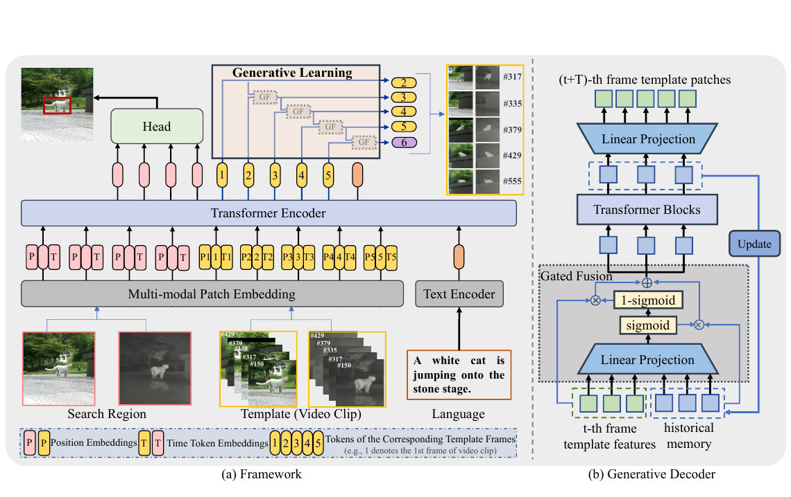

# TGTrack

[](https://openaccess.thecvf.com/content/CVPR2026/html/Geng_TGTrack_Temporal_Generative_Learning_for_Unified_Single_Object_Tracking_CVPR_2026_paper.html)

**TGTrack: Temporal Generative Learning for Unified Single Object Tracking**  
Wanting Geng, Xin Chen, Chuanyu Sun, Jie Zhao, Ben Kang, Dong Wang, Huchuan Lu

PyTorch implementation of TGTrack, accepted by **CVPR 2026**. TGTrack supports RGB, RGB-Depth, RGB-Thermal, RGB-Event and RGB-Language tracking within a unified framework.

[Paper](https://openaccess.thecvf.com/content/CVPR2026/papers/Geng_TGTrack_Temporal_Generative_Learning_for_Unified_Single_Object_Tracking_CVPR_2026_paper.pdf) · [Supplement](https://openaccess.thecvf.com/content/CVPR2026/supplemental/Geng_TGTrack_Temporal_Generative_CVPR_2026_supplemental.pdf) · [Models](https://huggingface.co/wwwttt1127/TGTrack/tree/main/checkpoints/train/tgtrack) · [Training Logs](https://huggingface.co/wwwttt1127/TGTrack/tree/main/logs) · [Model Zoo](MODEL_ZOO.md)

## Highlights

- **Temporal generative learning.** A training objective predicts subsequent template appearances and supervises temporal dynamics.
- **Gated autoregressive decoder.** Historical information and current template features are fused for temporal prediction.
- **Time token embedding.** Learnable temporal embeddings describe the ordering of template frames.
- **Unified tracking.** One framework handles five tracking tasks; the generative decoder is used during training only.



## Performance

We compare TGTrack-B256 with representative trackers from our [paper](https://openaccess.thecvf.com/content/CVPR2026/papers/Geng_TGTrack_Temporal_Generative_Learning_for_Unified_Single_Object_Tracking_CVPR_2026_paper.pdf) and [supplement](https://openaccess.thecvf.com/content/CVPR2026/supplemental/Geng_TGTrack_Temporal_Generative_CVPR_2026_supplemental.pdf). All results are reported in percentages, with the best result in each column shown in **bold**. Results for other TGTrack variants are available in the [Model Zoo](MODEL_ZOO.md).

### RGB-based tracking

| Tracker | Source | LaSOT (AUC) | LaSOT_ext (AUC) | TrackingNet (AUC) | GOT-10K (AO) |
| --- | --- | ---: | ---: | ---: | ---: |
| **TGTrack-B256 (Ours)** | CVPR 2026 | **74.6** | **53.2** | **86.2** | **80.8** |
| SUTrack-B224 | AAAI 2025 | 73.2 | 53.1 | 85.7 | 77.9 |
| ODTrack-B384 | AAAI 2024 | 73.2 | 52.4 | 85.1 | 77.0 |
| LoRAT-B378 | ECCV 2024 | 72.9 | 53.1 | 84.2 | 73.7 |
| ARTrackV2-256 | CVPR 2024 | 71.6 | 50.8 | 84.9 | 75.9 |

### RGB-Depth, RGB-Thermal and RGB-Event tracking

| Tracker | Source | VOT-RGBD22 (EAO) | DepthTrack (F-score) | LasHeR (AUC) | RGBT234 (MSR) | VisEvent (AUC) |
| --- | --- | ---: | ---: | ---: | ---: | ---: |
| **TGTrack-B256 (Ours)** | CVPR 2026 | **77.4** | **65.5** | **61.7** | **69.9** | **63.9** |
| SUTrack-B224 | AAAI 2025 | 76.5 | 65.1 | 59.9 | 69.5 | 62.7 |
| XTrack-L | ICCV 2025 | 74.0 | 64.8 | 58.7 | 65.4 | 63.3 |
| SDSTrack | CVPR 2024 | 72.8 | 61.9 | 53.1 | 62.5 | 59.7 |
| OneTracker | CVPR 2024 | 72.7 | 60.9 | 53.8 | 64.2 | 60.8 |
| ViPT | CVPR 2023 | 72.1 | 59.4 | 52.5 | 61.7 | 59.2 |

### RGB-Language tracking

| Tracker | Source | TNL2K (AUC) | TNL2K (P) | OTB99 (AUC) | OTB99 (P) |
| --- | --- | ---: | ---: | ---: | ---: |
| **TGTrack-B256 (Ours)** | CVPR 2026 | **65.4** | **68.7** | **72.5** | **95.2** |
| SUTrack-B224 | AAAI 2025 | 65.0 | 67.9 | 70.8 | 93.4 |
| MMTrack | TCSVT 2023 | 58.6 | 59.4 | 70.5 | 91.8 |
| OneTracker | CVPR 2024 | 58.0 | 59.1 | 69.7 | 91.5 |
| JointNLT | CVPR 2023 | 56.9 | 58.1 | 65.3 | 85.6 |

## Install the environment

The default environment uses Python 3.9 and PyTorch 1.11.0 with CUDA 11.3. Run the following commands from the TGTrack root directory:

```bash
conda create -n tgtrack -c conda-forge python=3.9 pip libjpeg-turbo
conda activate tgtrack
bash install.sh
export PYTHONPATH="$(pwd)${PYTHONPATH:+:$PYTHONPATH}"
```

For DepthTrack and VOT-RGBD22 evaluation, also install the VOT/TraX dependencies:

```bash
python -m pip install -r requirements-eval.txt
```

## Data Preparation

Put the tracking datasets in `./data`. It should look like:

For RGB tracking:

```text
${TGTrack_ROOT}
 -- data
     -- lasot
         |-- airplane
         |-- basketball
         |-- bear
         ...
     -- lasot_extension_subset
         |-- <category>
             |-- <sequence>
             ...
     -- got10k
         |-- test
         |-- train
         |-- val
     -- coco
         |-- annotations
         |-- images
     -- trackingnet
         |-- TRAIN_0
         |-- TRAIN_1
         ...
         |-- TRAIN_11
         |-- TEST
     -- vasttrack
         |-- Aardwolf
         |-- Accessory Box
         ...
         |-- Zither
```

For Multi-Modal tracking (`RGB-T234` and `otb_lang` are evaluation-only):

```text
${TGTrack_ROOT}
 -- data
     -- depthtrack
         -- train
             |-- adapter02_indoor
             |-- bag03_indoor
             |-- bag04_indoor
             ...
     -- lasher
         -- trainingset
             |-- 1boygo
             |-- 1handsth
             |-- 1phoneblue
             ...
         -- testingset
             |-- 1blackteacher
             |-- 1boycoming
             |-- 1stcol4thboy
             ...
     -- RGB-T234
         |-- afterrain
         |-- aftertree
         |-- baby
         ...
     -- visevent
         -- train
             |-- 00142_tank_outdoor2
             |-- 00143_tank_outdoor2
             |-- 00144_tank_outdoor2
             ...
         -- test
             |-- 00141_tank_outdoor2
             |-- 00147_tank_outdoor2
             |-- 00197_driving_outdoor3
             ...
     -- tnl2k_train
         |-- Arrow_Video_ZZ04_done
         |-- Assassin_video_1-Done
         |-- Assassin_video_2-Done
         ...
     -- tnl2k
         |-- advSamp_Baseball_game_002-Done
         |-- advSamp_Baseball_video_01-Done
         |-- advSamp_Baseball_video_02-Done
         ...
     -- lasot
         |-- airplane
         |-- basketball
         |-- bear
         ...
     -- otb_lang
         -- OTB_videos
             |-- Basketball
             |-- Biker
             |-- Bird1
             ...
         -- OTB_query_train
             |-- Basketball.txt
             |-- Bolt.txt
             |-- Boy.txt
             ...
         -- OTB_query_test
             |-- Biker.txt
             |-- Bird1.txt
             |-- Bird2.txt
             ...
```

## Set project paths

Configure the dataset, checkpoint and evaluation paths:

```bash
python tracking/create_default_local_file.py \
    --workspace_dir . --data_dir ./data --save_dir .
```

You can further customize the paths in these files:

```text
lib/train/admin/local.py       # Training paths
lib/test/evaluation/local.py   # Evaluation paths
```

The default `--save_dir .` loads evaluation checkpoints from `./checkpoints/`. To evaluate a model trained with `--save_dir ./outputs`, rerun the path configuration command with `--save_dir ./outputs`.

## Train TGTrack

Download the Fast-iTPN backbone weights and CLIP ViT-L/14 weights from [Hugging Face](https://huggingface.co/wwwttt1127/TGTrack/tree/main/pretrained) and place them in `./pretrained`:

```text
pretrained/
├── itpn/
│   ├── fast_itpn_tiny_1600e_1k.pt
│   ├── fast_itpn_small_1600e_1k.pt
│   ├── fast_itpn_base_clipl_e1600.pt
│   └── fast_itpn_large_1600e_1k.pt
└── clip/
    └── ViT-L-14.pt
```

Each configuration selects its backbone weights through `MODEL.ENCODER.PRETRAIN_TYPE`. Training logs for TGTrack-B256, B384, L256 and L384 are available [here](https://huggingface.co/wwwttt1127/TGTrack/tree/main/logs).

Train TGTrack-B256 on four GPUs:

```bash
torchrun --standalone --nproc_per_node 4 lib/train/run_training.py \
    --script tgtrack --config tgtrack_b256 --save_dir ./outputs
```

For single-GPU training or debugging:

```bash
python tracking/train.py --script tgtrack --config tgtrack_b256 \
    --save_dir ./outputs --mode single
```

Replace `tgtrack_b256` with another configuration in [experiments/tgtrack](experiments/tgtrack). Adjust `TRAIN.BATCH_SIZE` to fit your GPU memory. 

## Test and evaluate on benchmarks

Download the [trained checkpoints](https://huggingface.co/wwwttt1127/TGTrack/tree/main/checkpoints/train/tgtrack) and place them under `./checkpoints/train/tgtrack`:

```text
checkpoints/train/tgtrack/
├── tgtrack_t224/TGTrack_ep0180.pth.tar
├── tgtrack_s224/TGTrack_ep0180.pth.tar
├── tgtrack_b256/TGTrack_ep0180.pth.tar
├── tgtrack_b384/TGTrack_ep0180.pth.tar
├── tgtrack_l256/TGTrack_ep0180.pth.tar
└── tgtrack_l384/TGTrack_ep0180.pth.tar
```


### TGTrack for RGB-based tracking

#### LaSOT

```bash
python tracking/test.py tgtrack tgtrack_b256 --dataset lasot --threads 2
python tracking/analysis_results.py --config tgtrack_b256 --dataset lasot
```

#### LaSOT-extension

```bash
python tracking/test.py tgtrack tgtrack_b256 --dataset lasot_extension_subset --threads 2
python tracking/analysis_results.py --config tgtrack_b256 --dataset lasot_extension_subset
```

#### GOT-10K-test

```bash
python tracking/test.py tgtrack tgtrack_b256 --dataset got10k_test --threads 2
python lib/test/utils/transform_got10k.py --tracker_name tgtrack --cfg_name tgtrack_b256
```

#### TrackingNet

```bash
python tracking/test.py tgtrack tgtrack_b256 --dataset trackingnet --threads 2
python lib/test/utils/transform_trackingnet.py --tracker_name tgtrack --cfg_name tgtrack_b256
```

For GOT-10K and TrackingNet, submit the converted result archives to the official benchmark evaluation servers.

### TGTrack for multi-modal tracking

#### LasHeR

```bash
python RGBT_workspace/test_rgbt_mgpus.py \
    --script_name tgtrack --dataset_name LasHeR --yaml_name tgtrack_b256
```

#### RGBT234

```bash
python RGBT_workspace/test_rgbt_mgpus.py \
    --script_name tgtrack --dataset_name RGBT234 --yaml_name tgtrack_b256
```

#### VisEvent

```bash
python RGBE_workspace/test_rgbe_mgpus.py \
    --script_name tgtrack --dataset_name VisEvent --yaml_name tgtrack_b256
```

Use the official LasHeR, RGBT234 and VisEvent evaluation toolkits to calculate benchmark scores from the generated tracking results.

#### TNL2K

```bash
python tracking/test.py tgtrack tgtrack_b256 --dataset tnl2k --threads 2
python tracking/analysis_results.py --config tgtrack_b256 --dataset tnl2k
```

#### OTB99-Language

```bash
python tracking/test.py tgtrack tgtrack_b256 --dataset otb99_lang --threads 0
python tracking/analysis_results.py --config tgtrack_b256 --dataset otb99_lang
```

#### DepthTrack

Prepare the test sequences as described in [Depthtrack_workspace/README.md](Depthtrack_workspace/README.md), then run:

```bash
cd Depthtrack_workspace
vot evaluate tgtrack_b256
vot analysis tgtrack_b256 --nocache
cd ..
```

#### VOT-RGBD22

Prepare the test sequences as described in [VOT22RGBD_workspace/README.md](VOT22RGBD_workspace/README.md), then run:

```bash
cd VOT22RGBD_workspace
vot evaluate tgtrack_b256
vot analysis tgtrack_b256 --nocache
cd ..
```

By default, RGB and language tracking results are saved under `test/tracking_results/tgtrack/<config>/`. RGB-Thermal and RGB-Event results are saved under `RGBT_workspace/results/<dataset>/` and `RGBE_workspace/results/<dataset>/`, respectively. RGB-D results and analyses are saved in the corresponding VOT workspace.

For the Python tracking commands, add `--threads 2 --num_gpus 2` to use two GPUs, or `--sequence <sequence_name> --max_frames 2` for a short execution check. Short-run results are stored separately from full benchmark results.

## Model Zoo

Download the [trained models](https://huggingface.co/wwwttt1127/TGTrack/tree/main/checkpoints/train/tgtrack) and [training logs](https://huggingface.co/wwwttt1127/TGTrack/tree/main/logs) from Hugging Face. See [MODEL_ZOO.md](MODEL_ZOO.md) for individual download links, model configurations and benchmark results.


## Citation

If you find TGTrack useful in your research, please cite our paper:

```bibtex
@inproceedings{Geng_2026_CVPR,
  title={TGTrack: Temporal Generative Learning for Unified Single Object Tracking},
  author={Geng, Wanting and Chen, Xin and Sun, Chuanyu and Zhao, Jie and Kang, Ben and Wang, Dong and Lu, Huchuan},
  booktitle={Proceedings of the IEEE/CVF Conference on Computer Vision and Pattern Recognition (CVPR)},
  pages={28134--28144},
  month={June},
  year={2026}
}
```
